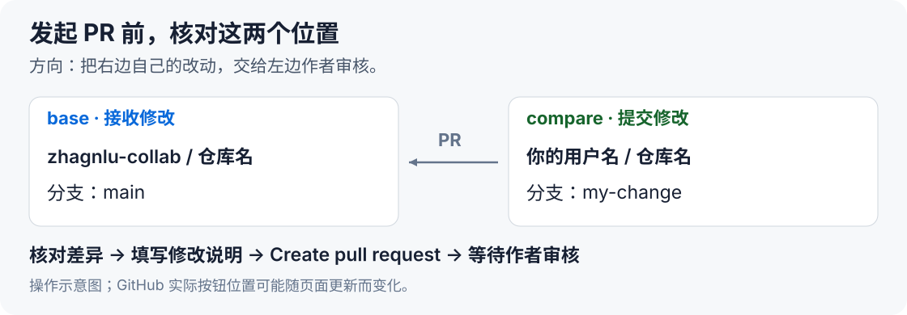

# ma-weekly-report

面向 A 股并购重组周报编制的 Codex Skill（v4.5.16），支持按统计截止日采集数据、更新底表并生成 Word/PDF/PPT，具体规则以 [SKILL.md](SKILL.md) 为准，成果须经复核后使用，不代表任何机构的官方口径或法律意见。

## MCP 与数据能力

**Wind MCP 与同花顺 iFinD MCP 至少配置一套，推荐双配交叉验证；见微公告检索可选。**

| 数据源 | 用途 | 对应 Skill |
|---|---|---|
| [Wind MCP](https://aifinmarket.wind.com.cn) | 行情、市值、行业、财务及公司资料 | `wind-mcp-skill` |
| [同花顺 iFinD MCP](https://mcp.51ifind.com/#/profile) | 行情、行业、公司资料及公告资讯 | `ifind-finance-data` |
| [见微数据](https://www.jianweidata.com)（可选） | 公告全文与披露细节补充核验 | `jianwei-agent-search` |

上述服务需自行配置账号及授权，不包含在本仓库中。连接后先做一次只读查询，确认可用；密钥勿提交到仓库。

交易所、巨潮和证监会公开信息可通过脚本或浏览器查询，无须专用 MCP。关键事实须回到公告或官方页面核验。

## 安装

### 1. 安装 skill

```bash
mkdir -p ~/.codex/skills
git clone https://github.com/zhagnlu-collab/ma-weekly-report.git \
  ~/.codex/skills/ma-weekly-report
```

也可以在 Codex 中直接打开本仓库目录使用。

### 2. 安装 Python 依赖

建议使用 Python 3.12 左右版本：

```bash
python3 -m pip install \
  openpyxl python-docx python-pptx pypdf pdfplumber PyMuPDF lxml
```

### 3. 配置文档与 PDF 工具

- 正式 Office 导出优先使用 Microsoft Word、Excel、PowerPoint。
- LibreOffice 可用于格式转换和预览，不作为正式发布版的唯一判定工具。
- PDF 逐页渲染检查需要 Poppler 的 `pdftoppm`，并应确保其位于 `PATH` 中。

### 4. 配置 MCP

在 Codex 的 MCP / 连接器设置中完成以下至少一套配置：

1. Wind MCP；或
2. 同花顺 iFinD MCP。

如需提高公告检索覆盖率，再配置见微公告检索。配置完成后，建议先运行一次只读股票查询，确认认证、权限和额度正常。

## 我想把自己改过的版本同步到这个GitHub页面，怎样操作？

**先 Fork，再 clone 自己的 Fork，是提交修改最简单、最不容易出错的流程。**

Fork 就是在自己的 GitHub 账号下复制一份仓库；clone 就是把自己的这份仓库下载到电脑。改好后，通过 **Pull Request（简称 PR）** 请作者审核并接收修改。


### 1. 先 Fork：复制到自己的账号

登录 GitHub，打开 [作者的仓库](https://github.com/zhagnlu-collab/ma-weekly-report)，点击右上角 **Fork**，再点击 **Create fork**。完成后，网页地址应变成 `github.com/你的用户名/ma-weekly-report`。

### 2. 再 clone：下载自己的 Fork

电脑需要先安装 [Git](https://git-scm.com/downloads)。在**自己的 Fork 页面**点击绿色 **Code → HTTPS**，复制地址。打开终端（Windows 可用 Git Bash），运行：

```bash
git clone https://github.com/YOUR-USERNAME/ma-weekly-report.git
cd ma-weekly-report
```

把 `YOUR-USERNAME` 换成你的 GitHub 用户名；也可以直接用刚才复制的地址。后续命令都在这个文件夹里运行。

### 3. 新建一个修改分支

分支可以理解为“专门放这次修改的一条线”：

```bash
git switch -c my-change
```

### 4. 在这个文件夹里让 AI 修改

用 AI Agent 打开刚刚 clone 的 `ma-weekly-report` 文件夹，告诉它要改什么。修改后的文件直接保存在这里。

**如果你之前已经下载 ZIP，并让 AI 改过：** 把 ZIP 文件夹中改过的文件，按原目录结构复制进这个 clone 文件夹，再继续下面的步骤。只复制改动文件，不要复制 `.git`、`.env`、密钥、缓存、日志或临时文件。

### 5. 检查改了什么

```bash
git status
git diff
python3 scripts/validate_skill.py
```

`git status` 列出改动文件，`git diff` 显示已跟踪文件的具体改动；新文件请直接打开检查。校验脚本需要 Python 3，Windows 中若使用 `python` 命令，请相应替换 `python3`。

看到 `Skill contribution validation passed.` 表示仓库校验通过；再确认文件内容符合你的修改目的。

### 6. 保存修改，并上传到自己的 Fork

```bash
git add .
git commit -m "说明这次改了什么"
git push -u origin my-change
```

`commit` 是在电脑上保存一条修改记录，`push` 是把它上传到自己的 GitHub Fork。首次提交若提示设置姓名和邮箱，按 Git 提示配置；上传若要求登录，按提示完成 GitHub 认证。

### 7. 发起 PR，请作者接收修改

回到自己的 Fork 页面，点击 **Compare & pull request**。如果没有看到按钮，可打开 **Pull requests → New pull request**，按需点击 **compare across forks**。核对：

- **base repository / base**：`zhagnlu-collab/ma-weekly-report` 的 `main`；
- **head repository / compare**：你自己的 `ma-weekly-report` 的 `my-change`。



填写修改说明，点击 **Create pull request**，等待作者审核。后续需要补改时，在同一分支继续修改，再执行 `git add .`、`git commit` 和 `git push`，同一个 PR 会随之更新。

**提交前：** 不要提交密码、密钥、客户资料、真实项目文件、个人信息或本机路径；请阅读 [CONTRIBUTING.md](CONTRIBUTING.md)。流程可参阅 [GitHub 官方贡献教程](https://docs.github.com/en/get-started/exploring-projects-on-github/contributing-to-a-project)。
