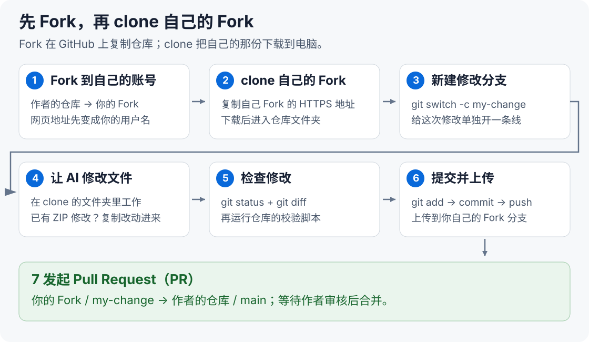

# ma-weekly-report

面向 A 股并购重组周报编制的 Codex skill，版本 **v4.5.16**。

该 skill 以“输入一个统计截止日，自动生成一套可复核的周报成果”为目标，覆盖期次推导、公告与交易所数据采集、13 个 Excel 底表更新、指标复核、Word/PDF/PPT 生成、逐页渲染检查和质量门禁。详细工作流、业务口径与限制以 [`SKILL.md`](SKILL.md) 为准。

> 本项目是个人工作流与研发成果，不代表任何机构的官方口径或法律意见。自动生成的成果均应按 `SKILL.md` 中的质量门禁复核，不得未经复核直接对外发布。

## MCP 与数据能力

**Wind MCP 与同花顺 iFinD MCP 至少配置一套，推荐双配交叉验证；见微公告检索可选。**

| 数据源 | 用途 | 对应 Skill |
|---|---|---|
| [Wind MCP](https://aifinmarket.wind.com.cn) | 行情、市值、行业、财务及公司资料 | `wind-mcp-skill` |
| [同花顺 iFinD MCP](https://mcp.51ifind.com/#/profile) | 行情、行业、公司资料及公告资讯 | `ifind-finance-data` |
| [见微数据](https://www.jianweidata.com)（可选） | 公告全文与披露细节补充核验 | `jianwei-agent-search` |

上述服务需自行配置账号及授权，不包含在本仓库中。连接后先做一次只读查询，确认可用；密钥勿提交到仓库。

交易所、巨潮和证监会公开信息可通过脚本或浏览器查询，无须专用 MCP。关键事实须回到公告或官方页面核验。

## 修改教程：先 Fork，再 clone 自己的 Fork

**先 Fork，再 clone 自己的 Fork，是提交修改最简单、最不容易出错的流程。**

Fork 就是在自己的 GitHub 账号下复制一份仓库；clone 就是把自己的这份仓库下载到电脑。改好后，通过 **Pull Request（简称 PR）** 请作者审核并接收修改。



### 1. 先 Fork：复制到自己的账号

登录 GitHub，打开 [作者的仓库](https://github.com/zhagnlu-collab/ma-weekly-report)，点击右上角 **Fork**，再点击 **Create fork**。完成后，网页地址应变成 `github.com/你的用户名/ma-weekly-report`。

### 2. 再 clone：下载自己的 Fork

电脑需要先安装 [Git](https://git-scm.com/downloads)。在**自己的 Fork 页面**点击绿色 **Code → HTTPS**，复制地址。打开终端（Windows 可用 Git Bash），运行：

```bash
git clone https://github.com/YOUR-USERNAME/ma-weekly-report.git
cd ma-weekly-report
```

把 `YOUR-USERNAME` 换成你的 GitHub 用户名；也可以直接用刚才复制的地址。后续命令都在这个文件夹里运行。

### 3. 新建一个修改分支

分支可以理解为“专门放这次修改的一条线”：

```bash
git switch -c my-change
```

### 4. 在这个文件夹里让 AI 修改

用 AI Agent 打开刚刚 clone 的 `ma-weekly-report` 文件夹，告诉它要改什么。修改后的文件直接保存在这里。

**如果你之前已经下载 ZIP，并让 AI 改过：** 把 ZIP 文件夹中改过的文件，按原目录结构复制进这个 clone 文件夹，再继续下面的步骤。只复制改动文件，不要复制 `.git`、`.env`、密钥、缓存、日志或临时文件。

### 5. 检查改了什么

```bash
git status
git diff
python3 scripts/validate_skill.py
```

`git status` 列出改动文件，`git diff` 显示已跟踪文件的具体改动；新文件请直接打开检查。校验脚本需要 Python 3，Windows 中若使用 `python` 命令，请相应替换 `python3`。

看到 `Skill contribution validation passed.` 表示仓库校验通过；再确认文件内容符合你的修改目的。

### 6. 保存修改，并上传到自己的 Fork

```bash
git add .
git commit -m "说明这次改了什么"
git push -u origin my-change
```

`commit` 是在电脑上保存一条修改记录，`push` 是把它上传到自己的 GitHub Fork。首次提交若提示设置姓名和邮箱，按 Git 提示配置；上传若要求登录，按提示完成 GitHub 认证。

### 7. 发起 PR，请作者接收修改

回到自己的 Fork 页面，点击 **Compare & pull request**。如果没有看到按钮，可打开 **Pull requests → New pull request**，按需点击 **compare across forks**。核对：

- **base repository / base**：`zhagnlu-collab/ma-weekly-report` 的 `main`；
- **head repository / compare**：你自己的 `ma-weekly-report` 的 `my-change`。


填写修改说明，点击 **Create pull request**，等待作者审核。后续需要补改时，在同一分支继续修改，再执行 `git add .`、`git commit` 和 `git push`，同一个 PR 会随之更新。

**提交前：** 不要提交密码、密钥、客户资料、真实项目文件、个人信息或本机路径；请阅读 [CONTRIBUTING.md](CONTRIBUTING.md)。流程可参阅 [GitHub 官方贡献教程](https://docs.github.com/en/get-started/exploring-projects-on-github/contributing-to-a-project)。

## 适用场景

- 编制或更新 A 股并购重组周报。
- 滚动维护重组底表、控制权变更、协议转让、IPO 终止、引战合作等 Excel。
- 根据上期成果和本期公告生成 Word、PDF、PPT 完整成果包。
- 复核已填数据与公告原文、交易所项目动态、证监会注册信息是否一致。
- 在既有模板上保留格式、公式、图表和跨表勾稽关系。

不适用于泛行业周报、单一并购案例研究或纯申报文件复核。

## 主要能力

- 按截止日自动推导期号、统计区间和上期模板。
- 采集上交所、深交所、北交所、巨潮资讯、证监会等公开来源。
- 建立公告检索台账、全文核实台账和事件状态记录。
- 更新 **13 个 Excel 底表**，执行公式重算、跨表勾稽和标绿范围校验。
- 生成 **WORD/PDF 周报、WORD/PDF 市场动态、PPT/PDF 市场周报**。
- 通过质量门禁区分 `COMPLETE`、`COMPLETE_WITH_EXCEPTIONS` 和 `BLOCKED`。
- 保留断点与运行状态，重复运行同一输入时可跳过已完成阶段。

## 交付物

一次完整运行通常生成：

- 13 个原生 Excel 工作簿；
- 周报 Word、PDF；
- 市场动态 Word、PDF；
- 市场周报 PPT、PDF；
- 检索台账、全文核实台账、指标快照和运行状态；
- `validation-report.json` 等质量门禁文件；
- 《本期编制与待核说明》（存在软门禁例外时）。

实际文件数量及目录以当期模板和运行结果为准。`COMPLETE_WITH_EXCEPTIONS` 表示结构已生成但仍有待核事项，不等同于内容已全部核实；`BLOCKED` 不视为可交付成果。

## 安装

### 1. 安装 skill

```bash
mkdir -p ~/.codex/skills
git clone https://github.com/zhagnlu-collab/ma-weekly-report.git \
  ~/.codex/skills/ma-weekly-report
```

也可以在 Codex 中直接打开本仓库目录使用。

### 2. 安装 Python 依赖

建议使用 Python 3.12 左右版本：

```bash
python3 -m pip install \
  openpyxl python-docx python-pptx pypdf pdfplumber PyMuPDF lxml
```

### 3. 配置文档与 PDF 工具

- 正式 Office 导出优先使用 Microsoft Word、Excel、PowerPoint。
- LibreOffice 可用于格式转换和预览，不作为正式发布版的唯一判定工具。
- PDF 逐页渲染检查需要 Poppler 的 `pdftoppm`，并应确保其位于 `PATH` 中。

### 4. 配置 MCP

在 Codex 的 MCP / 连接器设置中完成以下至少一套配置：

1. Wind MCP；或
2. 同花顺 iFinD MCP。

如需提高公告检索覆盖率，再配置见微公告检索。配置完成后，建议先运行一次只读股票查询，确认认证、权限和额度正常。

## 快速开始

先做计划推导，不执行采集和写文件：

```bash
cd ~/.codex/skills/ma-weekly-report
python3 scripts/auto_run.py --as-of YYYY-MM-DD --plan-only
```

确认期次、区间、模板和输出目录后执行完整流程：

```bash
python3 scripts/auto_run.py --as-of YYYY-MM-DD
```

如果是离线结构回放或已有官方 PDF，可使用：

```bash
python3 scripts/auto_run.py --as-of YYYY-MM-DD --offline
python3 scripts/auto_run.py --as-of YYYY-MM-DD --pdf-source-dir /path/to/office-pdf
```

运行目录和输出目录默认位于 skill 所在目录及其父目录附近，可通过 `--root`、`--work-root`、`--out-root` 或 `--config` 调整。完整参数说明见：

```bash
python3 scripts/auto_run.py --help
```

## 运行边界

- 生成结果默认是待复核稿，不代表已完成外部核验。
- 任何公告、法规、监管结论和统计数字都应回到原文核验。
- 股票行情、市值和行业字段必须记录查询日期、复权、币种和单位。
- MCP 结果与公告冲突时应并列保留来源，不得静默选择。
- 不得绕过验证码、权限或付费限制。
- 不得上传未经授权的内部材料、客户信息或个人信息。

## 目录结构

```text
.
├── SKILL.md          # 主技能说明与业务口径
├── README.md         # 安装、MCP 与使用说明
├── agents/           # Codex 界面入口配置
├── config/           # 无人值守配置示例
├── references/       # 检索、工作簿、质量门禁和演示规则
└── scripts/          # 采集、生成、复核与质量检查脚本
```

## 公开发布说明

- 仅发布 `ma-weekly-report/` 的正式文件，不包含备份、缓存、周报原始 Excel、录制、项目记忆或本机日志。
- 已移除本机绝对路径和微信文件路径；`pdftoppm` 改为从 `PATH` 查找。
- 本仓库不包含任何 MCP 密钥、API Key、账号密码或客户内部材料。

## 许可证

本项目采用 [MIT License](LICENSE)。在保留版权声明和许可证声明的前提下，可以自由使用、复制、修改、合并、发布、分发、再许可和销售本项目的副本。
